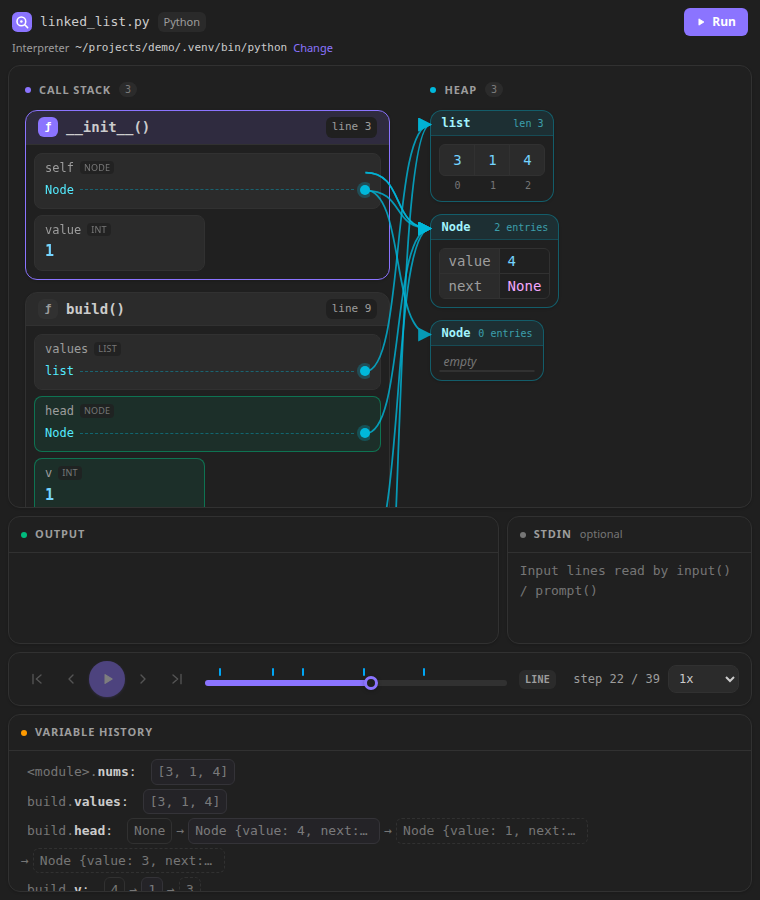

# CodeScope Viz

**See your code run.** CodeScope traces a Python or JavaScript file and lets you step through it
line by line: call-stack frames, variables, loops with iteration counters, and objects on the heap
with arrows for references. The line being shown is highlighted right in your editor.

Every value a variable has had is kept in the variable history, which makes bugs like off-by-one
errors easy to spot. It's made for learning, teaching, and understanding tricky code.

> CodeScope is in **preview**. Feedback and bug reports are welcome on
> [GitHub](https://github.com/Ayyoub-Boulahri/codescope-vscode/issues).

## Getting started

1. Open a `.py` or `.js` file.
2. Click the **telescope** button in the editor's title bar, or run **CodeScope Viz: Visualize File**
   from the Command Palette (`Ctrl+Shift+P` / `Cmd+Shift+P`).
3. Step through the run with the playback bar, or click in the panel and use the keyboard:
   `→` next step, `←` previous step, `Space` play/pause, `Home` / `End` first/last step.

In the editor, ▶ purple marks the current line, ▶ grey the next one, and ● red the line that
raised an error.

## Features

- **Call stack:** one card per function call with its local variables; changed values light up.
- **Heap:** lists, dicts, sets, objects and class instances, with arrows from the variables that
  point to them.
- **Loops:** the current iteration of every running loop, and buttons to jump between iterations.
- **Variable history:** every value each variable took. Click one to focus it, then jump to its
  next change.
- **Output and input:** see what the program printed so far at each step. Lines typed in the
  **stdin** box are what `input()` (Python) or `prompt()` (JavaScript) read.
- **Infinite-loop safe:** runs stop after 5,000 steps or 5 seconds and show what happened until
  then.

## Requirements

- **Python files:** Python 3.10 or newer. CodeScope uses the interpreter selected in the
  [Python extension](https://marketplace.visualstudio.com/items?itemName=ms-python.python), so
  your virtual environment and installed packages work. The panel shows which interpreter was used;
  click **Change** to pick another.
- **JavaScript files:** nothing extra; CodeScope runs them with the Node.js built into VS Code.

## Settings

| Setting | Default | Description |
|---|---|---|
| `codescopeViz.pythonPath` | *(empty)* | Interpreter for Python files. Empty: the one selected in the Python extension, else a `.venv` next to the file, else `python3` (`python` on Windows). |
| `codescopeViz.maxSteps` | `5000` | Stop recording after this many steps. |
| `codescopeViz.timeoutSeconds` | `5` | Stop a run after this many seconds. Raise it for programs with slow imports (e.g. `torch`). |

## Good to know

- **CodeScope runs your program**, like pressing Run would. It is disabled in untrusted
  workspaces ([Restricted Mode](https://code.visualstudio.com/docs/editor/workspace-trust)).
- Only the file itself is traced. Modules it imports (`import` in Python, `require()` in
  JavaScript) run normally but don't appear as frames.
- JavaScript: `import`/`export` (ES modules) are not supported yet; use `require()`. Async
  functions and generators show line steps only, and variables captured by closures are not shown.
- TypeScript and other languages are not supported yet.
- Editing the file hides the line highlights until you run it again, since the line numbers no
  longer match the recorded run.

## Also on the web

Try CodeScope in the browser, no install needed: **https://codescope-viz.netlify.app**

## License

[MIT](LICENSE)
